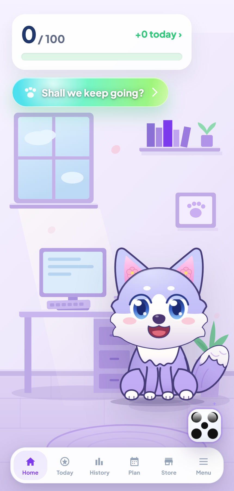
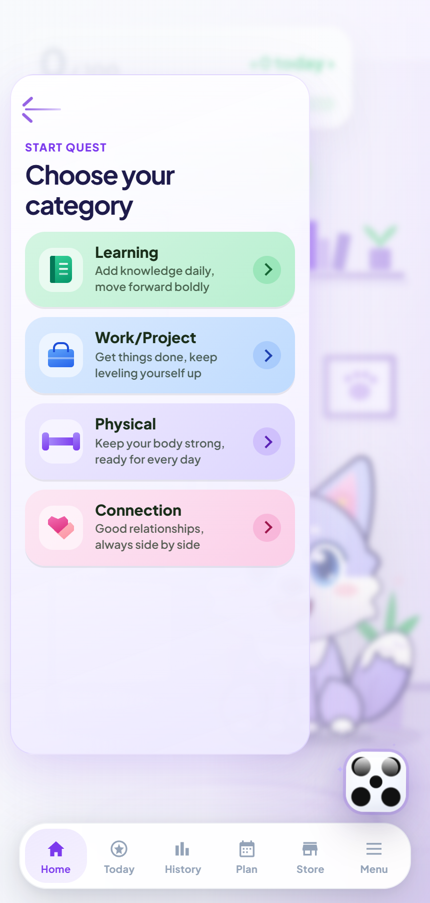
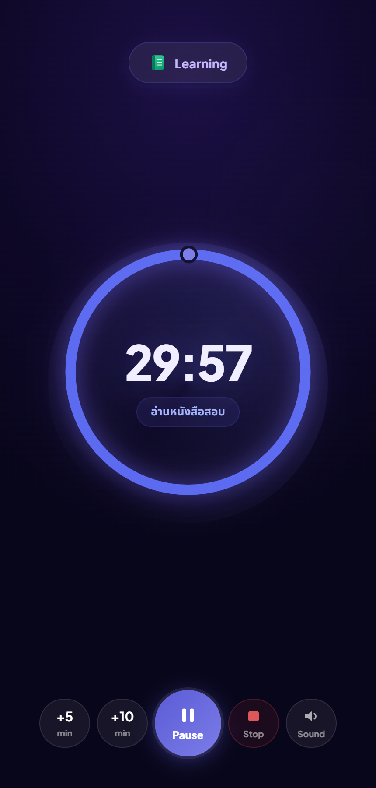

# SakuraQ

A quest-style focus timer that turns a planned session into points, streaks, history, and collectible interface skins. It ships as both an Android APK and an installable PWA.

## Why it is worth opening

- **35,000+ lines in one shipped HTML file.** The app has no framework, bundler, or compile step.
- **Timers survive the WebView closing.** The Android build schedules an OS alarm for the quest end time instead of trusting a background JavaScript loop.
- **Goals are user-defined.** Tags, colours, and plan-calendar sessions replaced the original fixed categories.
- **Sync does not mix users.** Firebase data and every local storage key are namespaced by account.
- **The mascot reacts without an LLM.** A deterministic observation engine scores recent events, applies cooldowns, and avoids repeating the same line.
- **Cosmetics change the whole scene.** Skins replace the home artwork, timer surface, controls, particles, and sound—not just an accent colour.

## Run it

Serve this folder with any static server. Opening `index.html` directly also works for most of the UI, but a server is required to exercise service-worker behaviour.

- [Installable web app](https://sakuraq-b7f96.web.app/welcome.html)
- [Latest Android release (APK)](https://github.com/sacmaib80-cmyk/Skr-v.0.11.2/releases/latest)

## Stack

Vanilla JavaScript · Capacitor · Firebase Auth and Firestore · Service Worker

## Release state

This repository is a curated snapshot of the **v0.18.27 source**. Android builds are published separately on the [release page](https://github.com/sacmaib80-cmyk/Skr-v.0.11.2/releases), and the newest build there is ahead of this snapshot.

## Honest notes

Ten people tested an early release and none retained; that result came from the usage tracking built into the app. The mascot's decision engine is implemented, but parts of its dialogue copy are still being rewritten.
